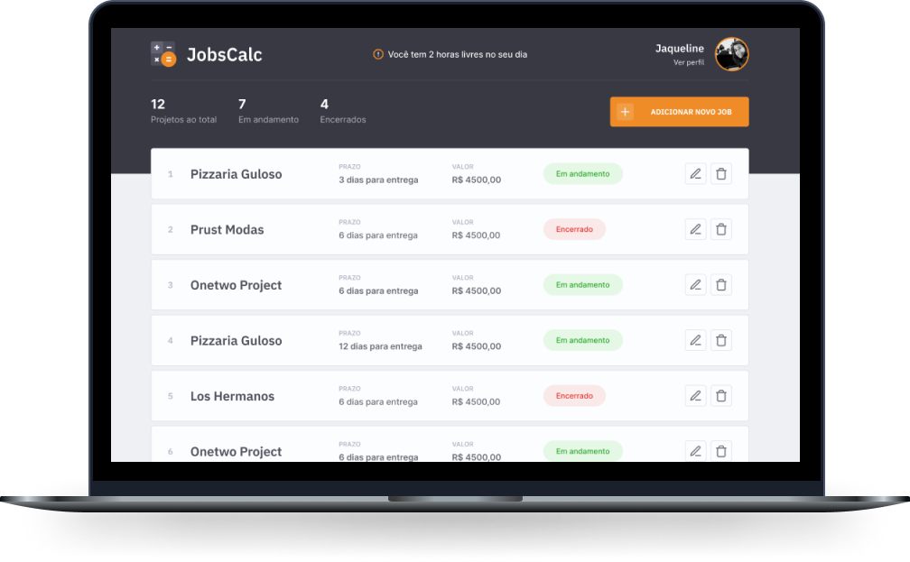
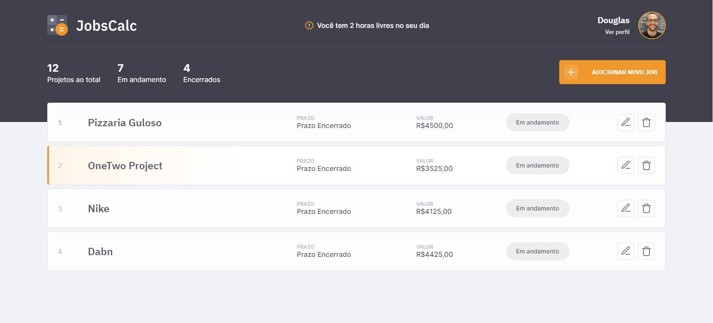

> **Projeto de estudo.** Estado conferido em 31/10/2026: os endereços que seguem fora do ar foram retirados deste README. Detalhes em [docs/AVALIACAO.md](docs/AVALIACAO.md) e próximos passos em [docs/PLANO-ESTRATEGICO.md](docs/PLANO-ESTRATEGICO.md).

<h1 align="center">
  
</h1>

<p align="center">Calculadora de freelas: valor da hora, orçamento e prazo de cada job.</p>

<p align="center"></p>

## 🧠 O que aprendi

> Proposta de 01/11/2026, escrita a partir do código e das dependências. Ajuste com a sua experiência.

- Modelar um cálculo de negócio (valor de projetos) no servidor com Express e EJS.
- Guardar dados em SQLite com `better-sqlite3`.
- Proteger cabeçalhos com Helmet.
- Testar a aplicação com `node --test`.

## Estado e próximos passos (ciclo de 03/11/2026)

**O que foi feito** (06/11/2026, PRs #16 e #17)
- O perfil mostra as horas de trabalho por mês usadas no valor da hora.
- Foco visível em duas cores, que aparece também no cabeçalho escuro.
- Teste da página 500; agora são 13 testes.
- CI também nos PRs para `developer/**`.
- Código legado removido (`routes.js`, `controllers`, `model`, `db/config.js`, `ci/`); `npm audit` sem alertas.
- `docs/MVP.md` revisto pela régua de estudo: 7 de 10 critérios aplicáveis.

**O que queremos fazer**
- [#13](https://github.com/douglasabnovato/jobs-calc/issues/13) Percentual de horas faturáveis no perfil.
- [#14](https://github.com/douglasabnovato/jobs-calc/issues/14) Teste do cadastro de job no navegador.
- [#15](https://github.com/douglasabnovato/jobs-calc/issues/15) `better-sqlite3` 12 para instalar no Node 24.
- [#10](https://github.com/douglasabnovato/jobs-calc/issues/10) Proteger a `master` (responsável).
- [#11](https://github.com/douglasabnovato/jobs-calc/issues/11) Decidir o histórico com o banco da renda mensal (responsável).
- [#12](https://github.com/douglasabnovato/jobs-calc/issues/12) Decidir a publicação: o link do Render deu 404 em 06/11 (responsável).

**Onde está a documentação**
- [docs/MVP.md](docs/MVP.md): critérios e estado.
- [docs/PLANO-DE-ACAO.md](docs/PLANO-DE-ACAO.md): seção "Ciclo de 03/11/2026", com pesquisa, backlog e engenharia.

## Problema e proposta

Quem trabalha como freelancer costuma cobrar "no chute". O JobsCalc parte da renda mensal desejada, dos dias e horas de trabalho e das férias para calcular o **valor da hora**, e usa esse valor para orçar cada job e mostrar quantas horas livres sobram no dia.

- **Público:** freelancers de desenvolvimento e design.
- **Métrica de sucesso:** jobs orçados por mês (`GET /health` mostra o total).

## Funcionalidades

- Perfil com renda mensal, horas/dia, dias/semana e semanas de férias → valor da hora, com as horas por mês usadas no cálculo.
- Jobs com orçamento (R$) e prazo (dias) calculados; status em andamento/encerrado.
- Painel com contagens e horas livres no dia.
- Números com vírgula (`2,5`, `1.234,56`), erros por campo e confirmação acessível ao excluir.
- Proteção opcional por usuário/senha (`APP_USER`/`APP_PASSWORD`) e bloqueio de POST de outra origem.

## Stack

Node 22 · Express 4 · EJS · SQLite (better-sqlite3) · helmet · node:test + supertest.

## Como rodar

```sh
npm install
cp .env.example .env    # opcional
npm run dev             # http://localhost:3000
npm test                # 13 testes
```

Para reaproveitar dados de uma cópia local antiga do banco, que não está mais no Git, rode uma vez com `DATABASE_FILE=./dbjobscalc.sqlite`: a migration converte os valores para centavos e mantém os jobs.

## Publicação

- **Publicação:** Fora do ar desde a conferência de 31/10/2026, com 404 também em 06/11/2026 (#12); para ver o projeto, rode localmente (seção "Como rodar"). O `render.yaml` continua no repositório.
- GitHub Pages não serve aqui: o projeto tem servidor Express e banco SQLite, e o Pages só publica arquivos estáticos.
- **`APP_USER` e `APP_PASSWORD` são obrigatórios em produção**: sem eles qualquer pessoa com o link edita os jobs. O Render pede os dois ao criar o serviço.
- O SQLite de produção fica em `/tmp/jobs-calc.sqlite`: perfil e jobs **somem a cada reinício ou deploy**.
- Passo a passo completo: [docs/DEPLOY.md](docs/DEPLOY.md).

## Documentação

[docs/ANALISE.md](docs/ANALISE.md) · [docs/ARQUITETURA.md](docs/ARQUITETURA.md) · [docs/PLANO-DE-ACAO.md](docs/PLANO-DE-ACAO.md) · [docs/DEPLOY.md](docs/DEPLOY.md)

## Licença

MIT — veja [.github/LICENSE.md](.github/LICENSE.md). Projeto da NLW (Rocketseat), evoluído por [@douglasabnovato](https://github.com/douglasabnovato).
