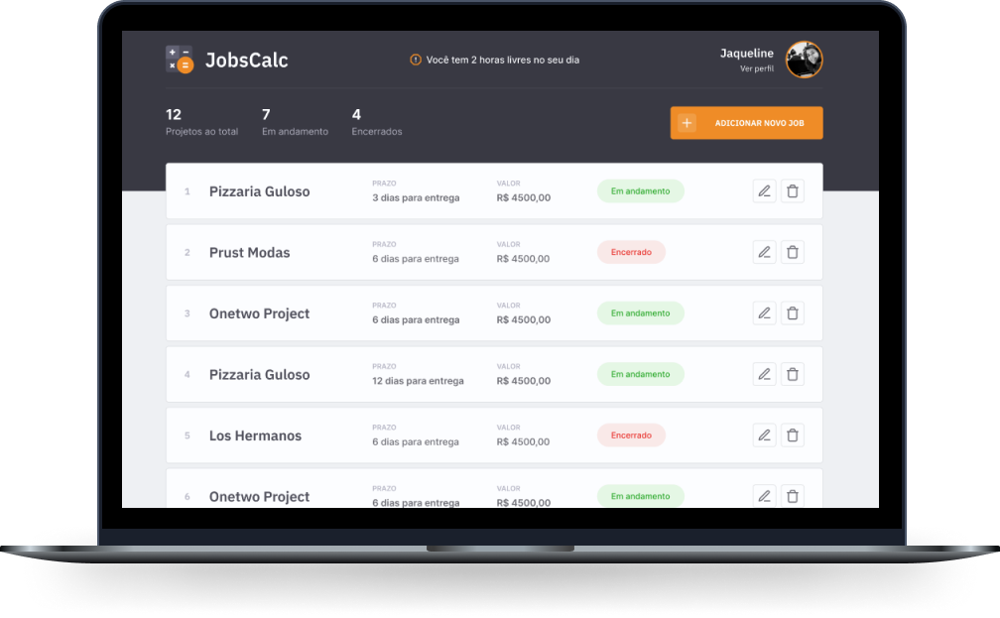
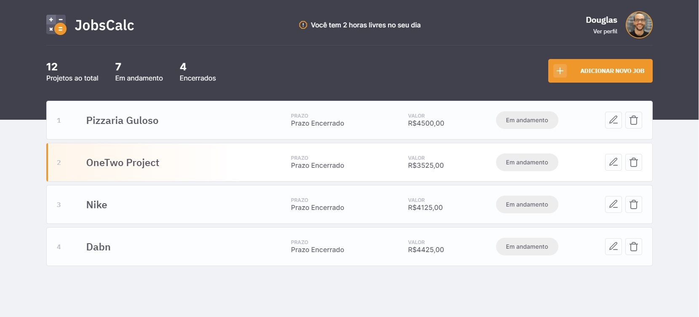

> **Projeto de estudo.** Estado conferido em 31/10/2026: os endereços que seguem fora do ar foram retirados deste README. Detalhes em [docs/AVALIACAO.md](docs/AVALIACAO.md) e próximos passos em [docs/PLANO-ESTRATEGICO.md](docs/PLANO-ESTRATEGICO.md).

<h1 align="center">
  
</h1>

<p align="center">Calculadora de freelas: valor da hora, orçamento e prazo de cada job.</p>

<p align="center"></p>

## 🧠 O que aprendi

> Proposta de 01/11/2026, escrita a partir do código e das dependências. Ajuste com a sua experiência.

- Modelar um cálculo de negócio (valor de projetos) no servidor com Express e EJS.
- Guardar dados em SQLite com `better-sqlite3`.
- Proteger cabeçalhos com Helmet.
- Testar a aplicação com `node --test`.

## Estado e próximos passos (ciclo de 16/11/2026)

Projeto de estudo (N1): 9 de 10 critérios aplicáveis atendidos. **Finalizado**: o que falta (#11) depende do responsável. A `master` está protegida, com os checks `raiz` e `interface` obrigatórios. O projeto não está publicado (o endereço do Render dá 404, #12): rode localmente.

**O que foi feito**
- 06/11 (PRs #16 e #17): horas por mês no perfil, foco visível em duas cores, teste da página 500, CI nos PRs para `developer/**`, código legado removido.
- 07/11 (PR #18, na `master` pelo PR #22 em 16/11): os formulários voltaram a salvar no navegador; percentual de horas cobradas do cliente no perfil (#13); testes de interface com Playwright e axe no CI (#14).
- 16/11 (PR #24): POST sem `Origin` e sem `Referer` recebe 403 (#21); fundo inerte com a confirmação de exclusão aberta (#19); `better-sqlite3` 12 e testes também no Node 24 (#15); o teste "modo escuro" saiu, porque o app não tem tema escuro próprio.

**O que queremos fazer**
- [#27](https://github.com/douglasabnovato/jobs-calc/issues/27) Testar no navegador a tela de edição do job.
- [#30](https://github.com/douglasabnovato/jobs-calc/issues/30) Usar o `<dialog>` nativo na confirmação de exclusão.
- [#28](https://github.com/douglasabnovato/jobs-calc/issues/28) Atualizar o Express para a versão 5.
- [#29](https://github.com/douglasabnovato/jobs-calc/issues/29) Atualizar o EJS para a 7 e o `better-sqlite3` para a 13.
- [#25](https://github.com/douglasabnovato/jobs-calc/issues/25) Mesclar o ciclo de 16/11 na `master` (responsável).
- [#26](https://github.com/douglasabnovato/jobs-calc/issues/26) Ligar os alertas do Dependabot (responsável).
- [#11](https://github.com/douglasabnovato/jobs-calc/issues/11) Decidir o histórico com o banco da renda mensal (responsável).
- [#12](https://github.com/douglasabnovato/jobs-calc/issues/12) Decidir a publicação no Render: o endereço deu 404 em 16/11 (responsável).

**Onde está a documentação**
- [docs/MVP.md](docs/MVP.md): critérios e estado.
- [docs/PLANO-DE-ACAO.md](docs/PLANO-DE-ACAO.md): seção "Ciclo de 16/11/2026", com pesquisa, backlog e engenharia.
- [docs/DEPLOY.md](docs/DEPLOY.md): passo a passo da publicação no Render.

## Problema e proposta

Quem trabalha como freelancer costuma cobrar "no chute". O JobsCalc parte da renda mensal desejada, dos dias e horas de trabalho e das férias para calcular o **valor da hora**, e usa esse valor para orçar cada job e mostrar quantas horas livres sobram no dia.

- **Público:** freelancers de desenvolvimento e design.
- **Métrica de sucesso:** jobs orçados por mês (`GET /health` mostra o total).

## Funcionalidades

- Perfil com renda mensal, horas/dia, dias/semana, semanas de férias e percentual do tempo cobrado do cliente → valor da hora, com as horas por mês usadas no cálculo.
- Jobs com orçamento (R$) e prazo (dias) calculados; status em andamento/encerrado.
- Painel com contagens e horas livres no dia.
- Números com vírgula (`2,5`, `1.234,56`), erros por campo e confirmação acessível ao excluir.
- Proteção opcional por usuário/senha (`APP_USER`/`APP_PASSWORD`).
- Todo POST precisa vir do próprio site: sem `Origin` e sem `Referer`, ou com origem de outro endereço, a resposta é 403.

## Stack

Node 22 ou 24 · Express 4 · EJS · SQLite (better-sqlite3) · helmet · node:test + supertest · Playwright + axe-core.

## Como rodar

```sh
npm install
cp .env.example .env    # opcional
npm run dev             # http://localhost:3000
npm test                # 17 testes de unidade
npx playwright install chromium   # uma vez
npm run test:e2e        # 8 testes no navegador (fluxo e axe)
```

Para reaproveitar dados de uma cópia local antiga do banco, que não está mais no Git, rode uma vez com `DATABASE_FILE=./dbjobscalc.sqlite`: a migration converte os valores para centavos e mantém os jobs.

## Publicação

- **Publicação:** Fora do ar desde a conferência de 31/10/2026, com 404 também em 16/11/2026 (#12); para ver o projeto, rode localmente (seção "Como rodar"). O `render.yaml` continua no repositório.
- GitHub Pages não serve aqui: o projeto tem servidor Express e banco SQLite, e o Pages só publica arquivos estáticos.
- **`APP_USER` e `APP_PASSWORD` são obrigatórios em produção**: sem eles qualquer pessoa com o link edita os jobs. O Render pede os dois ao criar o serviço.
- O SQLite de produção fica em `/tmp/jobs-calc.sqlite`: perfil e jobs **somem a cada reinício ou deploy**.
- Passo a passo completo: [docs/DEPLOY.md](docs/DEPLOY.md).

## Documentação

[docs/ANALISE.md](docs/ANALISE.md) · [docs/ARQUITETURA.md](docs/ARQUITETURA.md) · [docs/PLANO-DE-ACAO.md](docs/PLANO-DE-ACAO.md) · [docs/DEPLOY.md](docs/DEPLOY.md)

## Licença

MIT — veja [.github/LICENSE.md](.github/LICENSE.md). Projeto da NLW (Rocketseat), evoluído por [@douglasabnovato](https://github.com/douglasabnovato).
